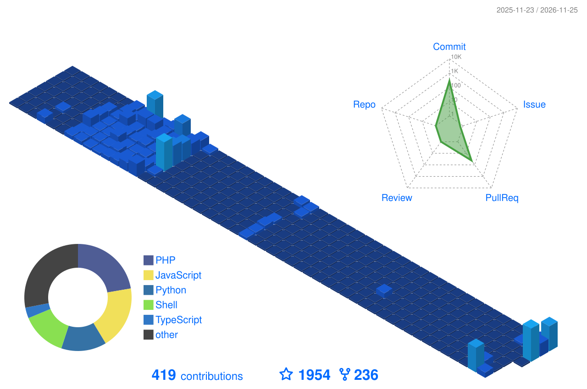
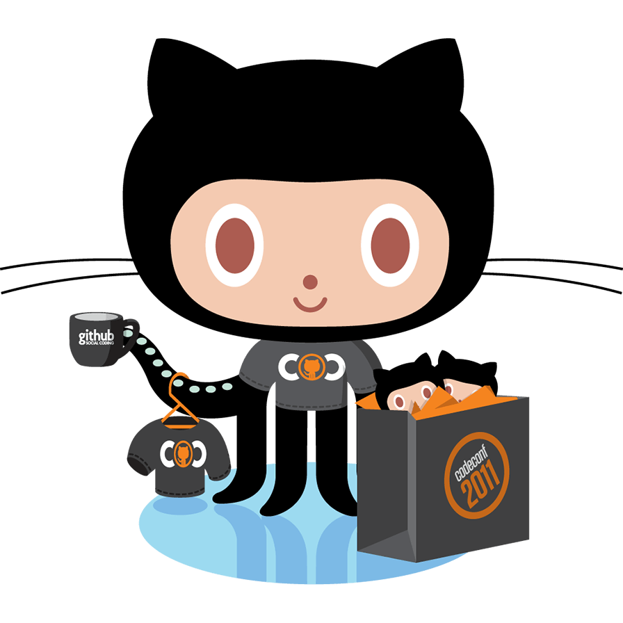

<h1 align="center">
  
</h1>

 
 

  <table>
      <tr>
        <td align="center">
          <a href="README.md">🇬🇧 Passer en Anglais</a>
        </td>
        <td align="center">
          <a href="README_de.md">🇩🇪 Passer en Allemand</a>
        </td>
        <td align="center">
          <a href="README_it.md">🇮🇹 Passer en Italien</a>
        </td>
    </tr>
  </table>

 

  **Bienvenue sur mon profil GitHub !**
  
  Je suis un ingénieur Full-Stack passionné et contributeur open-source avec plus de 2 ans d'expérience pratique, spécialisé dans des technologies largement reconnues telles qu'Angular, Spring Boot, Quarkus, Android, Node.js, Symfony, Go et DevOps. 
  
  Mon parcours dans le monde de la programmation a été guidé par une profonde curiosité et un désir de créer des applications efficaces, évolutives et conviviales.

 
  
<h2>🌟 À propos de moi</h2>

  - 💻 Je me spécialise en JS, PHP et Java, mais j'aime aussi explorer d'autres technologies et langages. 
  - 🚀 Je suis toujours désireux d'apprendre de nouvelles choses et de relever de nouveaux défis. Je suis toujours désireux d'apprendre de nouvelles choses et de relever de nouveaux défis. 
  - 🎓 Je crois au pouvoir du partage de connaissances et de l'open source. 

 
  
<h2>🛠️ Compétences et expertise</h2>

  - **Backend :** Node.js, Express.js, NestJS, Go, Symfony. 
    - **Frontend :** Angular, HTML, SCSS, CSS, Bootstrap. 
    - **Langages de programmation :** JavaScript, TypeScript, Php, Python, Go, C++. 
    - **Bases de données :** PostgreSQL, MySQL, MongoDB, Firebase, SQLite. 
    - **Outils :** Git, Docker, K8s, Jenkins, Lens, Kafka, Redis, Argocd, Portainer, ELK-Stack, Grafana, Graylog, Prometheus. 
    - **Langues :** Anglais, Français, Arabe.

   
     
  💡 Je m'épanouis dans les défis et j'aime apprendre de nouvelles technologies pour résoudre des problèmes complexes. Je m'épanouis face aux défis et j'aime apprendre de nouvelles technologies pour résoudre des problèmes complexes. Je suis toujours désireux de collaborer sur des projets passionnants et de contribuer à la communauté technologique. 

 
  

 
  
<h2>🔭 Mes statistiques GitHub</h2>

  
 
    &nbsp;
   
      
    
      
    
      
    
      
    
    
    
📫 Connectons-nous et construisons quelque chose d'incroyable ensemble ! 
 
  

 
<h2>🚀 Technologies & Projets</h2>
 
 Je me spécialise dans la création d'applications évolutives, de services backend et de solutions DevOps en utilisant une variété de technologies modernes. 
  
 #### **💻 Développement Backend (60%):** 
  - **Node.js (Express.js et NestJS)** – Création d'API RESTful et GraphQL efficaces et évolutives. 
  - **Go** – Création de services backend haute performance. 
  - **PHP** – Développement d'applications web robustes en utilisant **Symfony**. 

 #### **☁️ DevOps et Cloud (30%):** 
  - **Kubernetes, Docker, ArgoCD, Jenkins** – Gestion des pipelines CI/CD et des applications conteneurisées. 
  - **Kafka, Redis, ELK-Stack, Prometheus, Grafana** – Assurer l'observabilité et la haute disponibilité. 
  
 #### **🤖 IA et Grands Modèles de Langage (LLM) (10%):** 
  - Expérimenter avec les **LLMs** pour des applications pilotées par l'IA. 
  - Mise en œuvre de **solutions basées sur le ML et l'IA** en utilisant Python et les services cloud.

<!--
 #### **🎨 Développement Frontend (5%):** 
 - **Angular** – Création d'applications web dynamiques et interactives. 
  -->
  
 💡 **Explorez mes dépôts** pour voir des projets utilisant ces technologies !

***

  

***

 
  <i>&copy; <a href="https://github.com/JawherKl/"> JawherKl </a> 2024 - Présent </i> 
  <i> Sous licence <a href="https://github.com/JawherKl/JawherKl/tree/master/LICENSE"> Licence Publique Générale GNU</a></i> 
    
  <kbd>Merci de votre visite 🙂</kbd>

